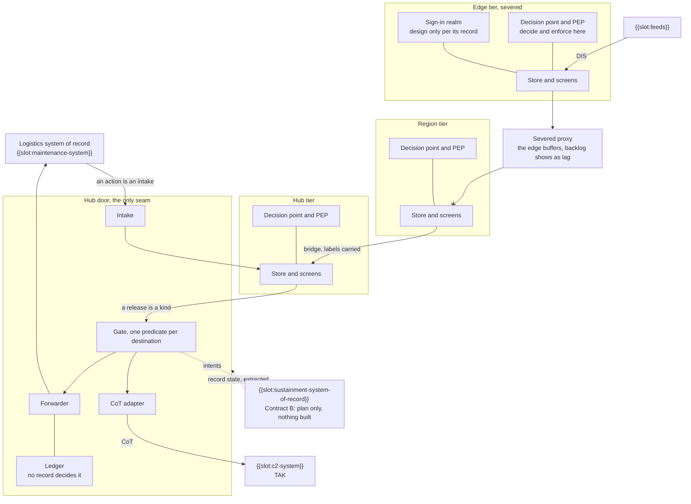

# Sample Fleet System: OV-3 Operational Resource Flow Matrix (DoDAF 2.02)

built on OpenDDIL 0.1.161

From UAF 1.2 Operational-Connectivity (Op-Cn).

Who needs what from whom. This view states the needs. The topics and workloads that carry them are in [Resources-Connectivity](../../views/Rs-Cn.md).

The bridge from the logistics system of record to the tactical side. The hub door is the only seam, and the picture shows one edge severed. Arrows are built. A dashed arrow is not built, and the node says so in words.

The logistics system of record reaches nothing below the door: releases leave it as declared kinds and actions enter it through intake. Severance cuts the proxy and leaves each tier whole, so a severed edge still takes its feeds, decides and enforces at its own decision point, and serves its screens. Its sign-in realm is drawn because the edge needs it while severed; its record still reads design only. CoT leaves only through the hub gate in this pass, so while an edge is severed its {{slot:c2-system}} gets nothing from this system.

| Need | From | To | Carries | Condition when severed |
|---|---|---|---|---|
| N1 | {{slot:feeds}} | Leaf tier | Entity state, faults, configuration | Local; unaffected |
| N2 | Child tier | Parent tier | Asset state and rollups | Buffers at the child; backlog visible as lag |
| N3 | Tier | Its operators | Picture, arrivals, releasable records | Works when the tier has its own broker and store |
| N4 | Hub | {{slot:c2-system}} | Status and readiness, gated per destination | Not stated |
| N5 | Hub | {{slot:maintenance-system}} | Fault records of a declared kind, gated | Not stated |
| N6 | {{slot:maintenance-system}} | Hub | Actions of a declared kind, through intake | Not stated |
| N7 | {{slot:sustainment-system-of-record}} | Sample Fleet System | Record state, extracted | Not stated |
| N8 | Sample Fleet System | {{slot:sustainment-system-of-record}} | Intents, for the record holder to accept or refuse | Held with custody at the tier |
| N9 | Operator | Tier | Declaration of an arriving asset | Local |
| N10 | Peer tier | Peer tier | Whatever a lateral link is configured for | Deployment configuration |

"Not stated" means no decision record says what this need does under severance. The hub is where the chain runs in this pass. Moving it to each tier is roadmap increment 2. Link figures: {{slot:link-characteristics}}.

## Sources

| Claim | Source | Decision | Evidence |
|---|---|---|---|
| N1: feeds enter at the tier that owns the sensor | [ADR-0030](../../../../decisions/ADR-0030-two-stage-configurable-ingress.md), [ADR-0044](../../../../decisions/ADR-0044-lifecycle-two-columns-no-deletes.md) | Accepted | Not stated |
| N2: the hop exists, can be severed and buffers | [ADR-0021](../../../../decisions/ADR-0021-edge-hq-topology-is-load-bearing.md) | Accepted | Built |
| N3: tier-local presentation | [ADR-0032](../../../../decisions/ADR-0032-tier-local-presentation-reachback-finding.md) | Accepted | Not stated |
| N4: release through the gate | [ADR-0043](../../../../decisions/ADR-0043-egress-gate-one-predicate-two-subjects.md) | Proposed | Measured under compose |
| N5, N6: release and intake by kind | [ADR-0046](../../../../decisions/ADR-0046-maintenance-bridge-events-out-actions-in.md) | Accepted | Not stated |
| N7, N8: Contract B reads records and writes intents | [Interface contracts](../../../../decisions/DESIGN-2026-09-06-interface-contracts.md) | Design note | Nothing built |
| N8: custody of an intent across tiers | [ADR-0042](../../../../decisions/ADR-0042-intent-custody-retention-and-multi-tier-reconciliation.md) | Proposed | Nothing built |
| N9: an asset enters by a person's declaration | [ADR-0050](../../../../decisions/ADR-0050-asset-arrivals-declare-and-expect.md) | Proposed | Not stated |
| N10: lateral links | [ADR-0033](../../../../decisions/ADR-0033-recursive-tier-hierarchy-framework-invariant.md) | Accepted | Pending |
| The door is the only seam to the system of record | [ADR-0046](../../../../decisions/ADR-0046-maintenance-bridge-events-out-actions-in.md) | Accepted | Not stated |
| Contract B crosses through the gate | [Interface contracts](../../../../decisions/DESIGN-2026-09-06-interface-contracts.md) | Design note | Nothing built |
| CoT leaves from the gate's sink at the hub | [CoT bridge](../../../../decisions/DESIGN-2026-10-01-cot-bridge.md) | Design note | Built |
| Severance cuts the proxy and leaves each tier whole | [ADR-0021](../../../../decisions/ADR-0021-edge-hq-topology-is-load-bearing.md) | Accepted | Built |
| A decision point at each tier | [Roadmap note](../../../../decisions/ROADMAP-2026-10-29-isolation-increments.md) | Roadmap note | Built |
| Labels carried across a bridge | [ADR-0029](../../../../decisions/ADR-0029-coalition-releasability-abac-enforcement.md) | Accepted | Built |
| A sign-in realm at each tier | [ADR-0045](../../../../decisions/ADR-0045-per-tier-identity-realm-replicas.md) | Accepted | Design only |
| Feeds enter as DIS at the edge | [ADR-0030](../../../../decisions/ADR-0030-two-stage-configurable-ingress.md) | Accepted | Not stated |
