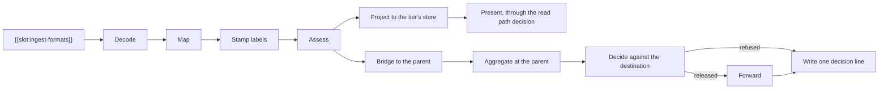

# Sample Fleet System: OV-5b Operational Activity Model (DoDAF 2.02)

built on OpenDDIL 0.1.161

From UAF 1.2 Operational-Processes (Op-Pr).

What the architecture does, as activities. [Resources-Traceability](../../views/Rs-Tr.md) ties each to the functions that perform it.

```mermaid
flowchart TB
    A0["Sustain a coalition's picture through severance"]
    A0 --> A1["A1 Take in a feed"]
    A0 --> A2["A2 Establish what an asset is"]
    A0 --> A3["A3 Assess each asset"]
    A0 --> A4["A4 Aggregate up the tiers"]
    A0 --> A5["A5 Present to an operator"]
    A0 --> A6["A6 Release to a destination"]
    A0 --> A7["A7 Take in from a destination"]
    A0 --> A8["A8 Reconcile intent with the record"]
    A1 --> A11["A1.1 Decode structure"]
    A1 --> A12["A1.2 Map semantics"]
    A1 --> A13["A1.3 Stamp labels"]
    A2 --> A21["A2.1 Declare or confirm an arrival"]
    A2 --> A22["A2.2 Account for configuration"]
    A2 --> A23["A2.3 Track effectors"]
    A3 --> A31["A3.1 Derive operational state"]
    A3 --> A32["A3.2 Keep status and reporting apart"]
    A3 --> A33["A3.3 Surface a disagreement"]
    A6 --> A61["A6.1 Assemble a record"]
    A6 --> A62["A6.2 Decide against the destination"]
    A6 --> A63["A6.3 Forward"]
    A7 --> A71["A7.1 Validate and check labels"]
    A7 --> A72["A7.2 Check the approvers"]
    A7 --> A73["A7.3 Refuse on an interlock"]
```

## Activity flow when an asset reports

## Sources

| Claim | Source | Decision | Evidence |
|---|---|---|---|
| A1.1, A1.2: structure then semantics, with no engine code per format | [ADR-0030](../../../../decisions/ADR-0030-two-stage-configurable-ingress.md) | Accepted | Not stated |
| A1.3: labels are stamped at ingress and carried, never re-derived | [ADR-0029](../../../../decisions/ADR-0029-coalition-releasability-abac-enforcement.md) | Accepted | Not stated |
| A2.1: declare or confirm; nothing is matched automatically | [ADR-0050](../../../../decisions/ADR-0050-asset-arrivals-declare-and-expect.md) | Proposed | Not stated |
| A2.2: configuration data model | [ADR-0009](../../../../decisions/ADR-0009-configuration-management-data-model.md) | Accepted | Not stated |
| A2.3: effectors and in-flight munitions are tracks, never assets | [ADR-0048](../../../../decisions/ADR-0048-effector-tracking-from-fire-and-detonation.md), [ADR-0049](../../../../decisions/ADR-0049-in-flight-munitions-tracked-by-munition-id.md) | Accepted | Not stated |
| A3.1: orthogonal state axes; absence is not a factor | [ADR-0026](../../../../decisions/ADR-0026-operational-state-orthogonal-axis-model.md) | Accepted | Not stated |
| A3.2: two columns | [ADR-0044](../../../../decisions/ADR-0044-lifecycle-two-columns-no-deletes.md) | Proposed | Built, unit-tested |
| A3.3: detection as disagreement between two named records; detection never enforces | [ADR-0053](../../../../decisions/ADR-0053-logistics-cyber-detection-as-surfaced-disagreement.md) | Accepted | Design only |
| A4: aggregation at each tier | [ADR-0022](../../../../decisions/ADR-0022-hierarchical-aggregation-is-the-architecture.md) | Accepted | Declared |
| A5: reads are decided at the read path | [ADR-0029](../../../../decisions/ADR-0029-coalition-releasability-abac-enforcement.md) | Accepted | Built |
| A6.1, A7.1, A7.2: by kind, with the assembler building from the picture | [ADR-0046](../../../../decisions/ADR-0046-maintenance-bridge-events-out-actions-in.md) | Accepted | Not stated |
| A6.2, A6.3: same predicate, destination as subject | [ADR-0043](../../../../decisions/ADR-0043-egress-gate-one-predicate-two-subjects.md) | Proposed | Measured under compose |
| A7.3: work release refused on an interlock | [ADR-0052](../../../../decisions/ADR-0052-safety-states-and-release-interlocks.md) | Accepted | Design only |
| A8: intent-based reconciliation | [ADR-0040](../../../../decisions/ADR-0040-offline-sustainment-and-intent-reconciliation.md) | Accepted | Nothing built |

The chart renders a release chain when a deployment enables it, so the status line of ADR-0043 may lag the chart. These views copy the ADR's words and do not re-verify them.
