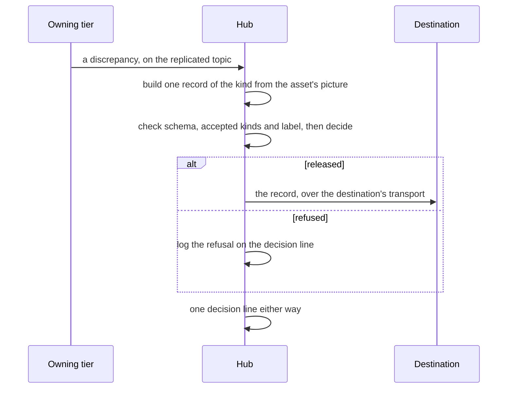
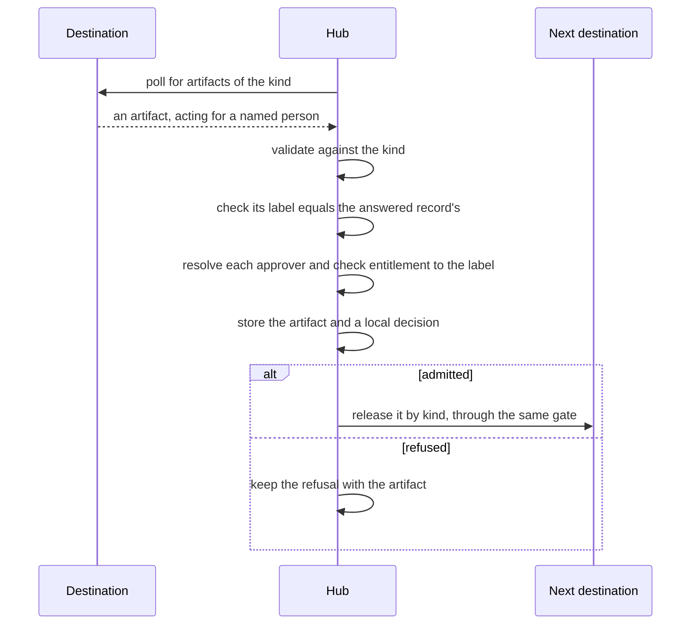

# Sample Fleet System: OV-6c Event-Trace Description (DoDAF 2.02)

built on OpenDDIL 0.1.161

From UAF 1.2 Operational-Sequences (Op-Sq).

The two exchanges with a destination, in order, between performers. [Resources-Sequences](../../views/Rs-Sq.md) holds the same steps between workloads. Destinations: {{slot:destinations}}. Kinds: {{slot:kinds}}.

In this pass both exchanges run at the hub, against one consumer instance that serves every tier. Running them at each tier is the design. The workflow, its approval routing, its pending tasks and its timers belong to the consumer. This architecture holds three things: the record it released, the artifact it took in, and its own decision about that artifact.

## Release by kind

One episode is one record. A second source inside an open episode is released as a revision of it. A fault that clears and comes back is a new episode. Each event carries its own id, and the episode id keeps an episode's events in order. Every id is deterministic, so a re-emission after a restart is a duplicate and is not sent again.

## Intake by kind

An artifact can answer a record the hub has not seen yet. That refusal is provisional: each poll decides it again, and once the record arrives the artifact goes through the remaining steps as if new. After a timeout (900 s by default) the refusal is final and states how long the hub waited.

A callback in place of the poll comes later, once a route from the consumer to the tier exists. The intake trusts the person named in the artifact only from a destination configured to allow it, and checks every approver anyway. Token exchange in place of that trust is the design. The link is not authenticated yet.

## Sources

| Claim | Source | Decision | Evidence |
|---|---|---|---|
| Release steps: build from the picture, check, decide, send | [ADR-0046](../../../../decisions/ADR-0046-maintenance-bridge-events-out-actions-in.md) | Accepted | Not stated |
| Intake steps, and the local decision kept with the artifact | [ADR-0046](../../../../decisions/ADR-0046-maintenance-bridge-events-out-actions-in.md) | Accepted | Not stated |
| Both run at the hub in this pass; the workflow is the consumer's | [ADR-0046](../../../../decisions/ADR-0046-maintenance-bridge-events-out-actions-in.md) | Accepted | Not stated |
| A refusal for an unknown answered record is provisional, then final | [ADR-0046](../../../../decisions/ADR-0046-maintenance-bridge-events-out-actions-in.md) | Accepted | Not stated |
| One id per event; the episode as its own field | [ADR-0046](../../../../decisions/ADR-0046-maintenance-bridge-events-out-actions-in.md) | Accepted | Not stated |
| The decision line, one predicate with the destination as subject | [ADR-0043](../../../../decisions/ADR-0043-egress-gate-one-predicate-two-subjects.md) | Proposed | Measured under compose |
