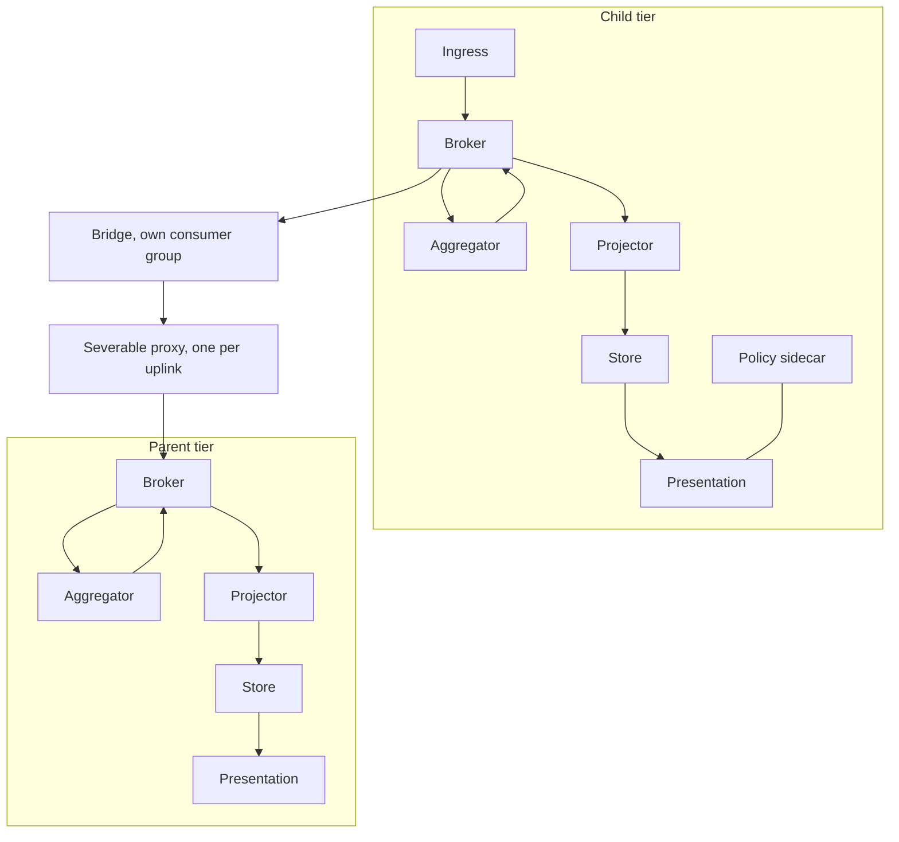
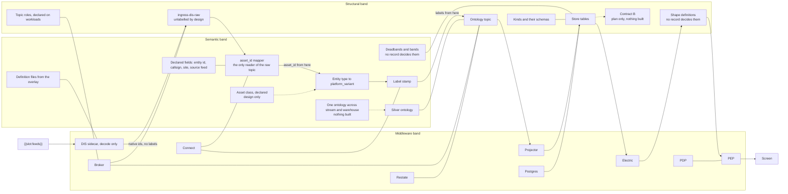

# Sample Fleet System: SV-2 Systems Resource Flow Description (DoDAF 2.02)

built on OpenDDIL 0.1.161

From UAF 1.2 Resources-Taxonomy (Rs-Tx).
From UAF 1.2 Resources-Structure (Rs-Sr).

## Resources-Taxonomy (Rs-Tx)

The resource types, what each one specialises, and where each is a part. The table is generated from package ResourceKit in [the model](../../model/openddil.sysml) when the view is rendered, so it cannot drift from the model. A type the model does not define fails the render. [Resources-Structure](../../views/Rs-Sr.md) shows the same package as a structure, and [Resources-Constraints](../../views/Rs-Ct.md) holds the rules a deployment's choice of members keeps.

| Type | Kind | Specialises | Is a part of, with multiplicity |
|---|---|---|---|
| KitMember | abstract | none | Uplink.bridge (multiplicity not stated); Uplink.proxy (multiplicity not stated) |
| Broker | member | KitMember | Node.broker [0..1] |
| Aggregator | member | KitMember | Node.aggregator [1] |
| Projector | member | KitMember | Node.projector [0..1] |
| Store | member | KitMember | Node.store [0..1] |
| Presentation | member | KitMember | Node.presentation [0..1] |
| PolicySidecar | member | KitMember | Node.policySidecar [0..1] |
| Uplink | composite | none | Node.uplink [0..1] |
| Node | composite | none | none |
| EgressGate | member | none | EgressChain.gate [1] |
| EgressAssembler | member | none | EgressChain.assembler [0..1] |
| EgressForwarder | member | none | EgressChain.forwarder [1] |
| EgressIntake | member | none | EgressChain.intake [0..1] |
| EgressChain | composite | none | none |

A multiplicity of `[0..1]` is a member a deployment may leave out of a tier. `[1]` is one it may not. A row that reads "multiplicity not stated" is one where the model gives none. Which members each tier carries is deployment configuration: {{slot:tier-tree}}.

### Sources

| Claim | Source | Decision | Evidence |
|---|---|---|---|
| The table | [ResourceKit](../../model/openddil.sysml) | Generated | Generated |
| The node kit: optional members, the aggregator universal | [ADR-0033](../../../../decisions/ADR-0033-recursive-tier-hierarchy-framework-invariant.md) | Accepted | Pending |
| The egress chain: at the hub in this pass, per tier later | [ADR-0046](../../../../decisions/ADR-0046-maintenance-bridge-events-out-actions-in.md) | Accepted | Declared |

## Resources-Structure (Rs-Sr)

A tier is one kit, and a deployment decides which members each tier carries. The deployment's tree: {{slot:tier-tree}}.

```sysml
package ResourceKit {
    doc /* ADR-0033 node kit. Every member but the aggregator is optional, under the dependency rules below. */

    abstract part def KitMember;
    part def Broker :> KitMember;
    part def Aggregator :> KitMember;
    part def Projector :> KitMember;
    part def Store :> KitMember;
    part def Presentation :> KitMember;
    part def PolicySidecar :> KitMember;

    part def Uplink {
        doc /* ADR-0021: one bridge, one consumer group and one severable proxy per child. */
        part bridge : KitMember;
        part proxy : KitMember;
    }

    part def Node {
        part broker : Broker[0..1];
        part aggregator : Aggregator[1];
        part projector : Projector[0..1];
        part store : Store[0..1];
        part presentation : Presentation[0..1];
        part policySidecar : PolicySidecar[0..1];
        part uplink : Uplink[0..1];

        doc /* Dependency rules, ADR-0033: a store needs a projector, presentation needs a store, and presentation that has to survive severance needs its own broker. */
    }

    part def EgressGate;
    part def EgressAssembler;
    part def EgressForwarder;
    part def EgressIntake;

    part def EgressChain {
        doc /* ADR-0046: at the hub in this pass; per tier is roadmap increment 2. */
        part assembler : EgressAssembler[0..1];
        part gate : EgressGate[1];
        part forwarder : EgressForwarder[1];
        part intake : EgressIntake[0..1];
    }
}
```

Model: [ResourceKit](../../model/openddil.sysml)



A store needs a projector, presentation needs a store, and presentation that has to survive severance needs its own broker.

The rendered chart today gives a region no broker of its own, so a region's rows in the generated view read `none rendered` in the Broker column. The kit allows either.

The ingestion path, drawn across three bands. The semantic band holds what a record means, the structural band holds the shapes it travels in, and the middleware band holds what moves it. Arrows are the path. A plain line ties a step to what declares or carries it. A dashed arrow is not built, and the node says so in words.



The asset_id boundary is the mapper: before it a record carries the feed's own ids, after it only `asset_id` and declared fields. The label boundary is the stamp: nothing reaches the ontology topic without labels, and the raw topic carries none by design, which is why nothing but the mapper may read it. The generated Data exchange view fails the render if any workload ever declares itself a reader of a raw ingest topic. No workload declares itself the mapper yet, so that topic reads `none declared` there.

### Sources

| Claim | Source | Decision | Evidence |
|---|---|---|---|
| The node kit and its dependency rules | [ADR-0033](../../../../decisions/ADR-0033-recursive-tier-hierarchy-framework-invariant.md) | Accepted | Pending |
| One bridge, one consumer group and one proxy per uplink | [ADR-0021](../../../../decisions/ADR-0021-edge-hq-topology-is-load-bearing.md) | Accepted | Built |
| A parent's own clients do not cross a link | [ADR-0021](../../../../decisions/ADR-0021-edge-hq-topology-is-load-bearing.md) | Accepted | Built |
| Regional aggregators run across clusters | [ADR-0024](../../../../decisions/ADR-0024-multi-cluster-faust-aggregator-pattern.md) | Accepted | Not stated |
| Presentation local to a tier | [ADR-0032](../../../../decisions/ADR-0032-tier-local-presentation-reachback-finding.md) | Accepted | Not stated |
| Which analytics run at a tier is configuration | [ADR-0034](../../../../decisions/ADR-0034-tier-analytics-are-deployment-configuration.md) | Accepted | Not stated |
| A policy decision point at each tier | [ADR-0029](../../../../decisions/ADR-0029-coalition-releasability-abac-enforcement.md) | Accepted | Built |
| Seams for a co-located reasoning plane | [ADR-0031](../../../../decisions/ADR-0031-converged-edge-node-reasoning-plane-seams.md) | Accepted | Not stated |
| Decode then semantics, with a topic as the seam | [ADR-0030](../../../../decisions/ADR-0030-two-stage-configurable-ingress.md) | Accepted | Not stated |
| Definition files come from the overlay | [ADR-0030](../../../../decisions/ADR-0030-two-stage-configurable-ingress.md) | Accepted | Not stated |
| Only the mapper reads the raw ingest topic | [ADR-0030](../../../../decisions/ADR-0030-two-stage-configurable-ingress.md), [ADR-0047](../../../../decisions/ADR-0047-asset-id-is-opaque.md) | Accepted | Declared |
| The mapper is the only code that knows an identity scheme | [ADR-0047](../../../../decisions/ADR-0047-asset-id-is-opaque.md) | Accepted | Not stated |
| Platform variant resolved at the feed boundary | [ADR-0016](../../../../decisions/ADR-0016-platform-variant-reconciliation.md) | Accepted | Not stated |
| Labels stamped at ingress | [ADR-0029](../../../../decisions/ADR-0029-coalition-releasability-abac-enforcement.md) | Accepted | Built |
| One ontology across stream and warehouse | [ADR-0041](../../../../decisions/ADR-0041-ontology-convergence-streaming-and-warehouse.md) | Accepted | Nothing built |
| Asset class is declared, not inferred | [Declared asset class](../../../../decisions/DESIGN-2026-08-11-declared-asset-class.md) | Design note | Design only |
| Kinds and their schemas | [ADR-0046](../../../../decisions/ADR-0046-maintenance-bridge-events-out-actions-in.md) | Accepted | Declared |
| Workloads declare the topics they use | [ADR-0054](../../../../decisions/ADR-0054-workload-annotations-declare-broker-use.md) | Accepted | Declared |
| One projector from broker to store | [ADR-0019](../../../../decisions/ADR-0019-single-kafka-postgres-projector.md) | Accepted | Not stated |
| Where Restate runs beside the stream processors | [ADR-0014](../../../../decisions/ADR-0014-restate-vs-faust-placement.md) | Accepted | Not stated |
| Contract B | [Interface contracts](../../../../decisions/DESIGN-2026-09-06-interface-contracts.md) | Design note | Nothing built |
