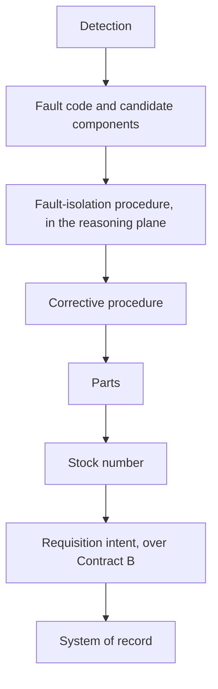

# Sample Fleet System: C2 Enterprise Vision (NAF v4)

built on OpenDDIL 0.1.161

From UAF 1.2 Strategic-Processes (St-Pr).

What this architecture is for, and the chain it exists to close. This is a positioning view. Nothing in it is built because of it, and [Strategic-Roadmap-Phasing](../../views/St-Rm-P.md) says what is.

## The vision

This architecture is the correlation layer between the tactical plane and the sustainment plane. It owns neither, speaks both, and keeps each side's provenance.

Readiness lives where the two planes meet, and neither represents it fully. A tactical system knows an asset is deployed and firing. A materiel system knows its authorised configuration, its stock on record and its open work orders. Whether a unit can sustain an operation is a question about both.

| Commitment | Statement |
|---|---|
| Correlate, do not transact | It carries a reference to an authoritative record made elsewhere, and its own derived view beside it. It does not create the work order, adjust the stock or close the requisition. A correlation layer that also transacts becomes a second system of record. |
| Keep both provenances | A correlated value says where each side's part came from: two timestamps, two identifiers, two claims. The correlation is a third artefact that cites both. |
| Correlate, never evaluate | A neutral join is adoptable by both communities because it asserts nothing either would dispute. A layer that scores options becomes a third opinion, adoptable by neither. |

## The chain

The technical manual's procedure is the middle of the bridge. Everything before it is this architecture's own derivation, and everything after it is someone else's system of record. A detection cannot become a requisition without a procedure that says which part. In a deployment the system of record is {{slot:sustainment-system-of-record}}.

When the system of record cannot be reached, the intent queues and is shown as unapplied, and everything before it still works.

## Sources

| Claim | Source | Decision | Evidence |
|---|---|---|---|
| The correlation layer, and readiness in the intersection | [ADR-0039](../../../../decisions/ADR-0039-bridging-tactical-and-sustainment-planes.md) | Positioning | Nothing built |
| The three commitments | [ADR-0039](../../../../decisions/ADR-0039-bridging-tactical-and-sustainment-planes.md) | Positioning | Nothing built |
| The chain, and the procedure as its middle | [ADR-0039](../../../../decisions/ADR-0039-bridging-tactical-and-sustainment-planes.md) | Positioning | Nothing built |
| The intent queues when the system of record is unreachable | [ADR-0040](../../../../decisions/ADR-0040-offline-sustainment-and-intent-reconciliation.md) | Accepted | Nothing built |
| The course-of-action fence the third commitment argues for | [ADR-0038](../../../../decisions/ADR-0038-anticipated-capability-envelope.md) | Accepted | Not stated |
