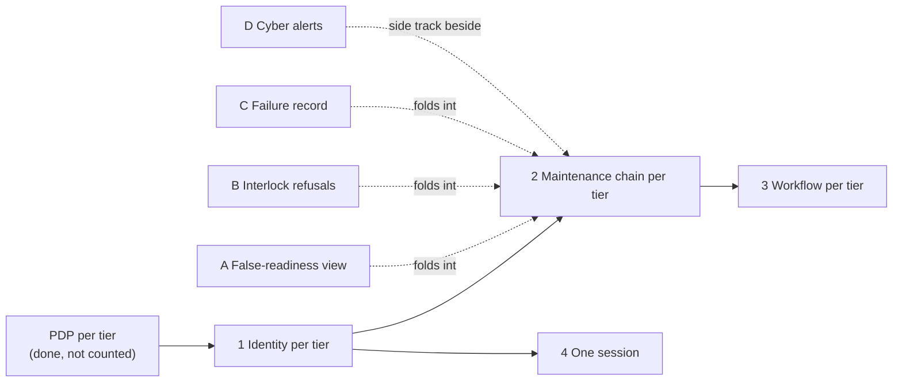

# Cr Capability Roadmap (NAF v4)

From UAF 1.2 Strategic-Roadmap-Phasing (St-Rm-P).

The order in which tiers become able to work alone. The roadmap note gives an order and its dependencies, and deliberately no dates. A deployment supplies them here: {{slot:increment-dates}}.

None of A to D is on an increment's critical path. Each can be dropped without moving the increment it folds into.

## Sources

| Claim | Source | Decision | Evidence |
|---|---|---|---|
| The order, the dependencies and the fold-ins | [Roadmap note](../../../../decisions/ROADMAP-2026-10-29-isolation-increments.md) | Roadmap note | Not stated |
| PDP per tier | [ADR-0029](../../../../decisions/ADR-0029-coalition-releasability-abac-enforcement.md) | Accepted | Built |
| 1 Identity per tier, 4 One session | [ADR-0045](../../../../decisions/ADR-0045-per-tier-identity-realm-replicas.md) | Accepted | Design only |
| 2 Maintenance chain per tier | [ADR-0046](../../../../decisions/ADR-0046-maintenance-bridge-events-out-actions-in.md) | Accepted | Not stated |
| 3 Workflow per tier | [ADR-0034](../../../../decisions/ADR-0034-tier-analytics-are-deployment-configuration.md) | Accepted | Not stated |
| A False-readiness view, D Cyber alerts | [ADR-0053](../../../../decisions/ADR-0053-logistics-cyber-detection-as-surfaced-disagreement.md) | Accepted | Design only |
| B Interlock refusals | [ADR-0052](../../../../decisions/ADR-0052-safety-states-and-release-interlocks.md) | Accepted | Design only |
| C Failure record | [ADR-0051](../../../../decisions/ADR-0051-failure-records-for-fracas.md) | Accepted | Design only |

The roadmap note says it is not a decision. An increment's own ADR is the decision.
