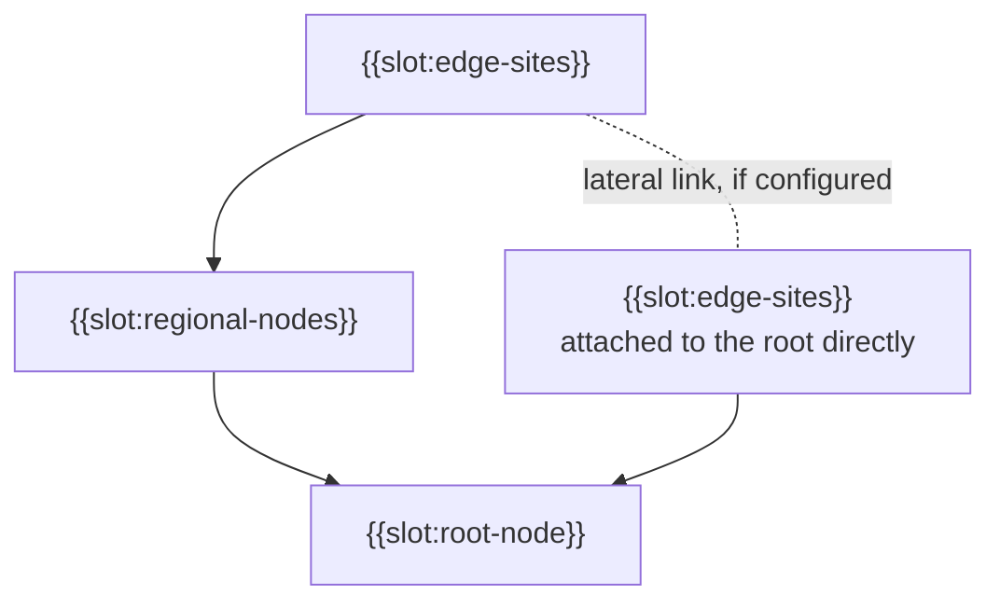

# Sample Fleet System: L2 Logical Scenario (NAF v4)

built on OpenDDIL 0.1.161

From UAF 1.2 Operational-Structure (Op-Sr).

The performers as a deployment arranges them. The whole tree: {{slot:tier-tree}}.

An arrow points from child to parent. Which tiers exist, how deep the tree goes and whether peers link laterally are all deployment configuration.

Each tier does its own work as a stream processor. Forwarding events up and grouping them at the root was rejected, because it would prove nothing about the streaming architecture.

## Sources

| Claim | Source | Decision | Evidence |
|---|---|---|---|
| Each tier aggregates for itself | [ADR-0022](../../../../decisions/ADR-0022-hierarchical-aggregation-is-the-architecture.md) | Accepted | Declared |
| Edge, region and root topology, three named regional topics | [ADR-0023](../../../../decisions/ADR-0023-hierarchy-restoration-topology-and-phase-plan.md) | Accepted | Declared |
| Edges under a region and edges directly under the root | [ADR-0021](../../../../decisions/ADR-0021-edge-hq-topology-is-load-bearing.md) | Accepted | Built |
| Depth and tier names are configuration; generalisation to any depth is deferred | [ADR-0033](../../../../decisions/ADR-0033-recursive-tier-hierarchy-framework-invariant.md) | Accepted | Pending |
| Lateral peer links | [ADR-0033](../../../../decisions/ADR-0033-recursive-tier-hierarchy-framework-invariant.md) | Accepted | Pending |
| A tier's screens work without the tier above | [ADR-0032](../../../../decisions/ADR-0032-tier-local-presentation-reachback-finding.md) | Accepted | Not stated |
