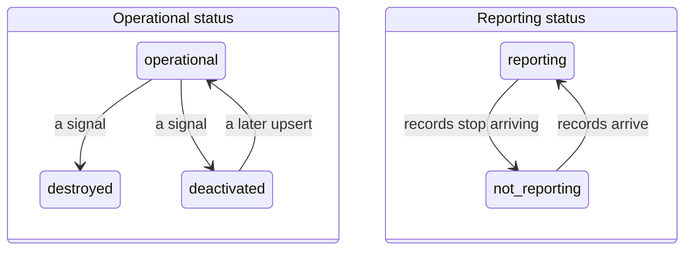
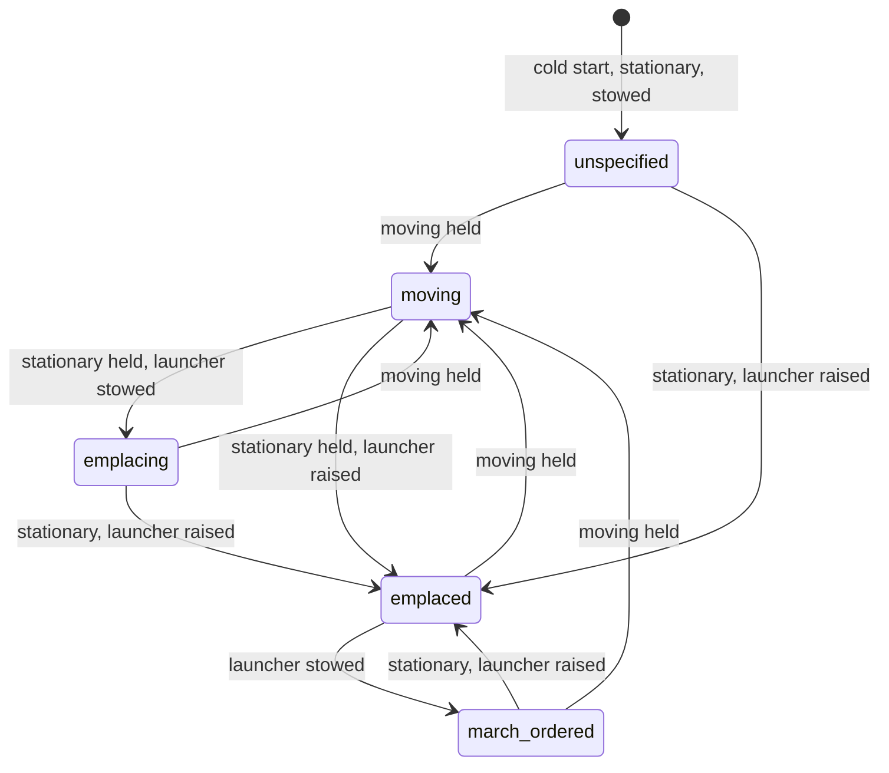
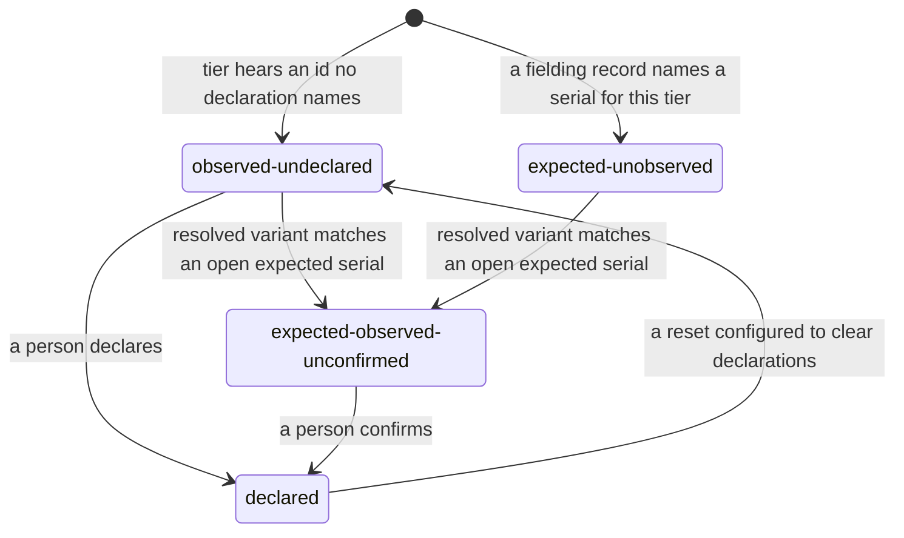

# Sample Fleet System: L5 Logical States (NAF v4)

built on OpenDDIL 0.1.161

From UAF 1.2 Operational-States (Op-St).

The states the operational record can claim, and what moves between them. The three machines are independent: none of them writes another's value.

## Status and reporting

Operational status says what is true of the asset. Reporting status says what is true of our knowledge of it, per reader. An asset can be destroyed and reporting at the same instant, which is why these are two columns and not one.

The diagram shows the values that the decision record's own cases name. The full value set belongs to the projector and is not repeated here.

## Posture

Decided per record from whether the launcher is raised and from speed, against two configurable holds. The first matching row in the decision record wins. `unspecified` is a claim of nothing and is never guessed.

A platform with no launcher bit only ever reads `moving` or `unspecified`.

## Arrival

The match only offers a candidate. A person ends all three states.

## Sources

| Claim | Source | Decision | Evidence |
|---|---|---|---|
| Two columns, each with its timestamp | [ADR-0044](../../../../decisions/ADR-0044-lifecycle-two-columns-no-deletes.md) | Proposed | Built, unit-tested |
| Posture states and transitions (amendment) | [ADR-0044](../../../../decisions/ADR-0044-lifecycle-two-columns-no-deletes.md) | Proposed | Not stated |
| Orthogonal axes under the operational state | [ADR-0026](../../../../decisions/ADR-0026-operational-state-orthogonal-axis-model.md) | Accepted | Not stated |
| The three arrival states; nothing is matched automatically | [ADR-0050](../../../../decisions/ADR-0050-asset-arrivals-declare-and-expect.md) | Proposed | Not stated |
