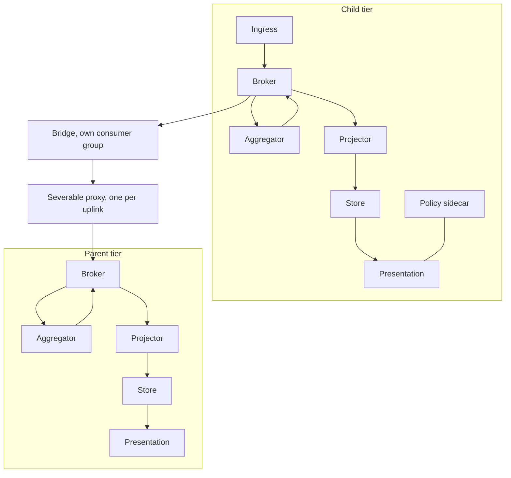

# Sample Fleet System: P2 Resource Structure (NAF v4)

built on OpenDDIL 0.1.161

From UAF 1.2 Resources-Structure (Rs-Sr).

A tier is one kit, and a deployment decides which members each tier carries. The deployment's tree: {{slot:tier-tree}}.

```sysml
package ResourceKit {
    doc /* ADR-0033 node kit. Every member but the aggregator is optional, under the dependency rules below. */

    abstract part def KitMember;
    part def Broker :> KitMember;
    part def Aggregator :> KitMember;
    part def Projector :> KitMember;
    part def Store :> KitMember;
    part def Presentation :> KitMember;
    part def PolicySidecar :> KitMember;

    part def Uplink {
        doc /* ADR-0021: one bridge, one consumer group and one severable proxy per child. */
        part bridge : KitMember;
        part proxy : KitMember;
    }

    part def Node {
        part broker : Broker[0..1];
        part aggregator : Aggregator[1];
        part projector : Projector[0..1];
        part store : Store[0..1];
        part presentation : Presentation[0..1];
        part policySidecar : PolicySidecar[0..1];
        part uplink : Uplink[0..1];

        doc /* Dependency rules, ADR-0033: a store needs a projector, presentation needs a store, and presentation that has to survive severance needs its own broker. */
    }

    part def EgressGate;
    part def EgressAssembler;
    part def EgressForwarder;
    part def EgressIntake;

    part def EgressChain {
        doc /* ADR-0046: at the hub in this pass; per tier is roadmap increment 2. */
        part assembler : EgressAssembler[0..1];
        part gate : EgressGate[1];
        part forwarder : EgressForwarder[1];
        part intake : EgressIntake[0..1];
    }
}
```

Model: [ResourceKit](../../model/openddil.sysml)



A store needs a projector, presentation needs a store, and presentation that has to survive severance needs its own broker.

The rendered chart today gives a region no broker of its own, so a region's rows in the generated view read `none rendered` in the Broker column. The kit allows either.

## Sources

| Claim | Source | Decision | Evidence |
|---|---|---|---|
| The node kit and its dependency rules | [ADR-0033](../../../../decisions/ADR-0033-recursive-tier-hierarchy-framework-invariant.md) | Accepted | Pending |
| One bridge, one consumer group and one proxy per uplink | [ADR-0021](../../../../decisions/ADR-0021-edge-hq-topology-is-load-bearing.md) | Accepted | Built |
| A parent's own clients do not cross a link | [ADR-0021](../../../../decisions/ADR-0021-edge-hq-topology-is-load-bearing.md) | Accepted | Built |
| Regional aggregators run across clusters | [ADR-0024](../../../../decisions/ADR-0024-multi-cluster-faust-aggregator-pattern.md) | Accepted | Not stated |
| Presentation local to a tier | [ADR-0032](../../../../decisions/ADR-0032-tier-local-presentation-reachback-finding.md) | Accepted | Not stated |
| Which analytics run at a tier is configuration | [ADR-0034](../../../../decisions/ADR-0034-tier-analytics-are-deployment-configuration.md) | Accepted | Not stated |
| A policy decision point at each tier | [ADR-0029](../../../../decisions/ADR-0029-coalition-releasability-abac-enforcement.md) | Accepted | Built |
| Seams for a co-located reasoning plane | [ADR-0031](../../../../decisions/ADR-0031-converged-edge-node-reasoning-plane-seams.md) | Accepted | Not stated |
