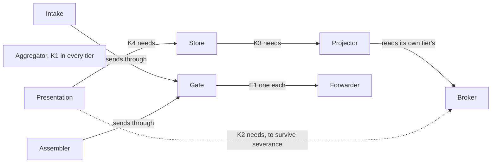

# Sample Fleet System: P8 Resource Constraints (NAF v4)

built on OpenDDIL 0.1.161

From UAF 1.2 Resources-Constraints (Rs-Ct).

The rules a deployment's choice of resources has to keep. They are framework rules and hold at any depth. Which tier carries which member is the deployment's choice within them: {{slot:tier-tree}}.

| Rule | Statement |
|---|---|
| K1 | Every tier carries an aggregator. A node that manages nothing below it is not a tier, so the aggregator is the one member no tier may leave out. |
| K2 | A presentation that has to survive severance needs its tier's own broker. Without a local topic set, its store is fed across the very link whose severance it exists to survive. |
| K3 | A store needs a projector, and the projector reads its own tier's topics. One projection path and one store shape at every tier. |
| K4 | A presentation needs a store at the same tier. The read contract is relational and the same at every tier. |
| K5 | Rollups compose. A tier aggregates its children's rollups, never the leaves. Counts, worst-of severities and latest-state upserts compose. Anything else is checked before it is trusted. |
| E1 | An egress chain has one gate and one forwarder. An assembler and an intake are optional. |
| E2 | Everything a chain sends passes its gate, and that includes an artifact the intake admits. |

[Resources-Structure](../../views/Rs-Sr.md) shows which members each tier carries in the render. [Resources-Taxonomy](../../views/Rs-Tx.md) lists the types and their multiplicities, as the model states them.

## Sources

| Claim | Source | Decision | Evidence |
|---|---|---|---|
| K1 to K4: the node kit's dependency rules | [ADR-0033](../../../../decisions/ADR-0033-recursive-tier-hierarchy-framework-invariant.md) | Accepted | Pending |
| K5: rollups must compose | [ADR-0033](../../../../decisions/ADR-0033-recursive-tier-hierarchy-framework-invariant.md) | Accepted | Pending |
| E1: the chain's multiplicities, as the model states them for this record | [ADR-0046](../../../../decisions/ADR-0046-maintenance-bridge-events-out-actions-in.md) | Accepted | Not stated |
| E2: the intake publishes through the same gate | [ADR-0046](../../../../decisions/ADR-0046-maintenance-bridge-events-out-actions-in.md) | Accepted | Not stated |
