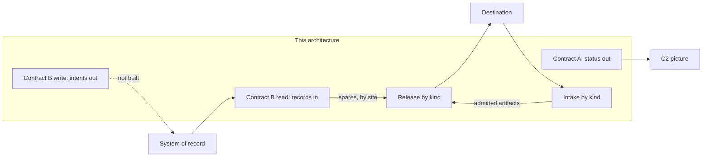

# Sample Fleet System: S3 Service Interfaces (NAF v4)

built on OpenDDIL 0.1.161

From UAF 1.2 Services-Connectivity (Sv-Cn).

The services this architecture offers across its boundary, which resources provide each, and what each carries. Nothing crosses a boundary ungated, and nothing that crosses is described as integrated until a conformance suite says so.

The peers in a deployment: the C2 picture is {{slot:c2-system}}, the system of record is {{slot:sustainment-system-of-record}}, and the destinations are {{slot:destinations}}.

## Services and the resources that provide them

| Resource | Contract A | Contract B read | Contract B write | Release | Intake |
|---|---|---|---|---|---|
| Egress gate | Decides, on its C2 route | | | Decides | Decides what is admitted onward |
| Egress forwarder | Sends | | | Sends | |
| Thin egress connector | Translates for one C2, and decides nothing | | | | |
| Egress assembler | | | | Builds the record | |
| Egress intake | | | | | Takes in |
| Connect pipeline, in the integrator's private overlay | | Extracts, read-only by credential | | | |
| Tier projector | | Lands the element planes in the store | | | |
| Not built | | | Intents only: propose, acknowledge, cancel at least | | |

## Services that feed services

| From | To | What passes |
|---|---|---|
| Contract B read | Release | The parts plane's stock per site, read into the asset's picture |
| Intake | Release | An admitted artifact, as a release request toward the next destination |
| The picture | Contract A | Status and readiness, after every releasability, severity and identity decision |

## What each service carries

| Service | Direction | Shape | Key |
|---|---|---|---|
| Contract A | Out | Status and readiness, in open vocabulary. The candidates are MIL-STD-2525 and APP-6, JC3IEDM, Cursor-on-Target, J-series, and FMC, PMC and NMC as the readiness projection. The choice is still open. | The asset |
| Contract B read, element planes | In | The planes' envelope, plus both identifiers side by side, the site, labels under provenance, the extraction cursor and time, the source's own readiness, and extras that no consumer may bind to | The asset |
| Contract B read, parts plane | In | Stock on hand, lead time, the source system, and the source's own nearest site with stock | Site and part |
| Contract B read, fielding plane | In | A serial owed to a site, its expected variant, its unit and when it is due | Serial |
| Contract B write | Out | Intents, never row updates. Where the target has no transactional write, an advisory queue that is labelled in the data and never applied automatically | Not decided |
| Release | Out | A record of a declared kind | The kind's key pointer |
| Intake | In | An artifact of a declared kind, naming the record it answers | The kind's key pointer |

Variants the fielding plane resolves to: {{slot:platform-variants}}.

## Not yet met

The design's own reading of the read side, kept here so that nothing above reads as integrated:

- Both identifiers survive the adapter to the topic, and the projector drops the sustainment identifier at landing.
- Telemetry labels land, and inventory rows land unlabelled.
- No write side is built, and the conformance kit covers reads only.
- The verb set beyond the minimum is undecided.

## Sources

| Claim | Source | Decision | Evidence |
|---|---|---|---|
| Contract A from open vocabulary; the thin connector translates and does not decide | [Interface contracts](../../../../decisions/DESIGN-2026-09-06-interface-contracts.md) | Design note | Nothing built |
| Contract B read: extraction, the catalog shape and its planes, the conformance kit | [Interface contracts](../../../../decisions/DESIGN-2026-09-06-interface-contracts.md) | Design note | Nothing built |
| Contract B write: intents, the degraded advisory queue | [Interface contracts](../../../../decisions/DESIGN-2026-09-06-interface-contracts.md) | Design note | Nothing built |
| Release and intake by kind; the C2 path as one route of the gate | [ADR-0046](../../../../decisions/ADR-0046-maintenance-bridge-events-out-actions-in.md) | Accepted | Declared |
| Both identifiers carried and never derived from each other | [ADR-0041](../../../../decisions/ADR-0041-ontology-convergence-streaming-and-warehouse.md) | Accepted | Nothing built |
| Gate and forwarder | [ADR-0043](../../../../decisions/ADR-0043-egress-gate-one-predicate-two-subjects.md) | Proposed | Measured under compose |
