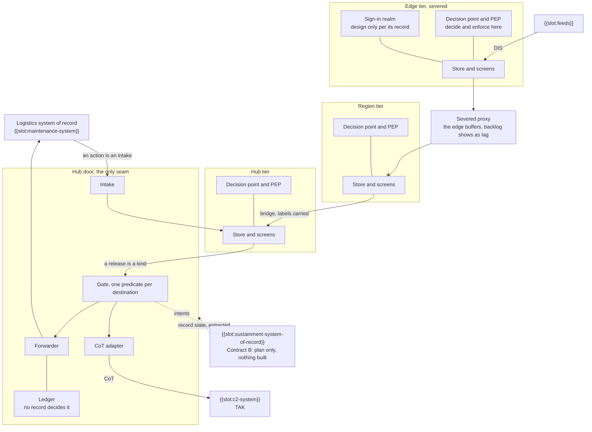

# Sample Fleet System: Operational-Connectivity (Op-Cn)

built on OpenDDIL 0.1.161

Who needs what from whom. This view states the needs. The topics and workloads that carry them are in [Resources-Connectivity](../../views/Rs-Cn.md).

The bridge from the logistics system of record to the tactical side. The hub door is the only seam, and the picture shows one edge severed. Arrows are built. A dashed arrow is not built, and the node says so in words.

The logistics system of record reaches nothing below the door: releases leave it as declared kinds and actions enter it through intake. Severance cuts the proxy and leaves each tier whole, so a severed edge still takes its feeds, decides and enforces at its own decision point, and serves its screens. Its sign-in realm is drawn because the edge needs it while severed; its record still reads design only. CoT leaves only through the hub gate in this pass, so while an edge is severed its {{slot:c2-system}} gets nothing from this system.

| Need | From | To | Carries | Condition when severed |
|---|---|---|---|---|
| N1 | {{slot:feeds}} | Leaf tier | Entity state, faults, configuration | Local; unaffected |
| N2 | Child tier | Parent tier | Asset state and rollups | Buffers at the child; backlog visible as lag |
| N3 | Tier | Its operators | Picture, arrivals, releasable records | Works when the tier has its own broker and store |
| N4 | Hub | {{slot:c2-system}} | Status and readiness, gated per destination | Not stated |
| N5 | Hub | {{slot:maintenance-system}} | Fault records of a declared kind, gated | Not stated |
| N6 | {{slot:maintenance-system}} | Hub | Actions of a declared kind, through intake | Not stated |
| N7 | {{slot:sustainment-system-of-record}} | Sample Fleet System | Record state, extracted | Not stated |
| N8 | Sample Fleet System | {{slot:sustainment-system-of-record}} | Intents, for the record holder to accept or refuse | Held with custody at the tier |
| N9 | Operator | Tier | Declaration of an arriving asset | Local |
| N10 | Peer tier | Peer tier | Whatever a lateral link is configured for | Deployment configuration |

"Not stated" means no decision record says what this need does under severance. The hub is where the chain runs in this pass. Moving it to each tier is roadmap increment 2. Link figures: {{slot:link-characteristics}}.

## Worked example: one fault record out, one action back (N5, N6)

A walk on a test deployment on 2026-11-10 carried one fault record out through N5 and its action back through N6. It
covered one asset at one edge tier and one fault on one item. Here it is called the walk's case. Times are UTC, and
every step was read on the deployment, apart from the last row, which is a prediction.

| Time | Need | What happened |
|---|---|---|
| 16:33 | none, N2, N5 | An operator filed the fault at the edge tier. The record rolled up to the hub, which released it: delivered, 200. The case id that came back was an earlier case's id for the same asset and item, not the new record's. The forwarder counted `case_id_mismatch` and delivered. |
| 19:47 | none, N2 | A supervisor resolved the open occurrence at the edge tier: 202. The entry cleared at the edge, its region and the hub within 2 s, the hub's picture dropped the occurrence at +3 s, and nothing was sent. |
| 19:52 | none, N2, N5 | The fault was filed again as a new occurrence: delivered, 200. This time the case id that came back equals the record's event id. The new case names the earlier one as its predecessor. The operator's card showed the link to the new case at 20:01. |
| 20:03 | | In {{slot:maintenance-system}}, a maintainer chose an option and approved it. |
| 20:08:00 | N6 | A supervisor approved the action, and {{slot:maintenance-system}} released it. |
| 20:08:18 | N6 | The intake refused the action, `schema_invalid`: three errors, all in `work_order.task_refs`. The declared `MaintenanceAction` kind wanted strings, and the action carried objects `{graph_uri, data_module_code}`. |
| Next roll | N6 | Predicted, not read: with the kind changed to the object shape and fix O2 deployed, the intake admits the action on its first poll and counts `schema_redecided` 1. |

### Findings, marked by side

**Sample Fleet System**

- **O1. The intake reads kinds only at start.** A changed kind schema reaches it only through a chart upgrade. The kinds
  checksum rolls four workloads (assembler, forwarder, gate and intake), with the upgrade's hooks. A schema change alone
  is not a light step.
- **O2. A corrected kind does not re-decide a final refusal.** The intake skips a final refusal whose body hash is
  unchanged ([ADR-0046](../../../../decisions/ADR-0046-maintenance-bridge-events-out-actions-in.md)), so this action would stay
  refused after the kind changed. It would be admitted only on a changed body from the other side. A fix is written and
  held for the next roll: a same-hash `schema_invalid` row whose body now passes the loaded schema is decided again, and
  every other same-hash row is still skipped. ADR-0046's amendment of 2026-11-10 records the rule.
- **O3. This view has no need for an operator's fault report.** The walk's filing, its resolve and its refile ran on a
  need the table does not hold. N1 covers faults from feeds, and N9 covers declarations of arrival. They are marked
  "none" above.
- **O4. The stand-in still answers in the old shape.** The stand-in that answers in place of {{slot:maintenance-system}}
  in tests sends `task_refs` as strings. Under the changed kind, its answers would be refused `schema_invalid`. Decided: the stand-in changes to the object shape, in the deployment's overlay, at the next roll.

**{{slot:maintenance-system}}**

- **M1. The first filing got an earlier case.** A new record was given an existing case's id. Sample Fleet System counts the
  mismatch and does not refuse it, so the card's case link pointed at the earlier case until the refile.
- **M2. The record fails its own published schema.** Validated against the schema published for the deployed version,
  the action record has 9 errors:
  - `graph_uri` is null where the schema says string (3);
  - five keys the schema does not have: `option` and `readiness` in `work_order`, and `case_definition`, `case_id` and
    `emitted_by` in `provenance`;
  - one nested list in `manual_nodes_consulted`.

  Their owner rules whether the record or the schema changes. The response body also adds four envelope keys that are
  not part of the record type, and these have to be removed before validating.

**Both: the shape of `task_refs` was never agreed.** Sample Fleet System's kind declared strings, and the other side sends objects.
The deployment's kind now follows the other side, with `graph_uri` allowed to be null. M2 rules on whether that holds.

O1, O2 and O4 are rows in [FOLLOW-UPS.md](../../../../decisions/FOLLOW-UPS.md). M1 and M2 belong to {{slot:maintenance-system}}'s owner.

## Sources

| Claim | Source | Decision | Evidence |
|---|---|---|---|
| N1: feeds enter at the tier that owns the sensor | [ADR-0030](../../../../decisions/ADR-0030-two-stage-configurable-ingress.md), [ADR-0044](../../../../decisions/ADR-0044-lifecycle-two-columns-no-deletes.md) | Accepted | Not stated |
| N2: the hop exists, can be severed and buffers | [ADR-0021](../../../../decisions/ADR-0021-edge-hq-topology-is-load-bearing.md) | Accepted | Built |
| N3: tier-local presentation | [ADR-0032](../../../../decisions/ADR-0032-tier-local-presentation-reachback-finding.md) | Accepted | Not stated |
| N4: release through the gate | [ADR-0043](../../../../decisions/ADR-0043-egress-gate-one-predicate-two-subjects.md) | Proposed | Measured under compose |
| N5, N6: release and intake by kind | [ADR-0046](../../../../decisions/ADR-0046-maintenance-bridge-events-out-actions-in.md) | Accepted | Not stated |
| Worked example: the refusal reason and the hash skip it met | [ADR-0046](../../../../decisions/ADR-0046-maintenance-bridge-events-out-actions-in.md) | Accepted | Not stated |
| N7, N8: Contract B reads records and writes intents | [Interface contracts](../../../../decisions/DESIGN-2026-09-06-interface-contracts.md) | Design note | Nothing built |
| N8: custody of an intent across tiers | [ADR-0042](../../../../decisions/ADR-0042-intent-custody-retention-and-multi-tier-reconciliation.md) | Proposed | Nothing built |
| N9: an asset enters by a person's declaration | [ADR-0050](../../../../decisions/ADR-0050-asset-arrivals-declare-and-expect.md) | Proposed | Not stated |
| N10: lateral links | [ADR-0033](../../../../decisions/ADR-0033-recursive-tier-hierarchy-framework-invariant.md) | Accepted | Pending |
| The door is the only seam to the system of record | [ADR-0046](../../../../decisions/ADR-0046-maintenance-bridge-events-out-actions-in.md) | Accepted | Not stated |
| Contract B crosses through the gate | [Interface contracts](../../../../decisions/DESIGN-2026-09-06-interface-contracts.md) | Design note | Nothing built |
| CoT leaves from the gate's sink at the hub | [CoT bridge](../../../../decisions/DESIGN-2026-10-01-cot-bridge.md) | Design note | Built |
| Severance cuts the proxy and leaves each tier whole | [ADR-0021](../../../../decisions/ADR-0021-edge-hq-topology-is-load-bearing.md) | Accepted | Built |
| A decision point at each tier | [Roadmap note](../../../../decisions/ROADMAP-2026-10-29-isolation-increments.md) | Roadmap note | Built |
| Labels carried across a bridge | [ADR-0029](../../../../decisions/ADR-0029-coalition-releasability-abac-enforcement.md) | Accepted | Built |
| A sign-in realm at each tier | [ADR-0045](../../../../decisions/ADR-0045-per-tier-identity-realm-replicas.md) | Accepted | Design only |
| Feeds enter as DIS at the edge | [ADR-0030](../../../../decisions/ADR-0030-two-stage-configurable-ingress.md) | Accepted | Not stated |
