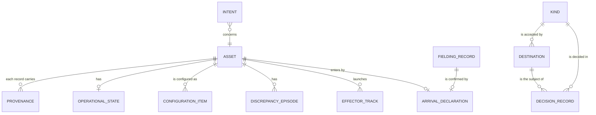

# Sample Fleet System: Operational-Information (Op-If)

built on OpenDDIL 0.1.161

The logical information model. Field names are local to this architecture: the standards in [Standards-Taxonomy](../../views/Sd-Tx.md) are aligned by concept name, and a binding is owed before any field is frozen. Bindings: {{slot:attribute-bindings}}. Variants: {{slot:platform-variants}}.

```sysml
package Information {
    doc /* Logical entities only. Field names are local to this architecture; the wire shape is in the proto contracts. */

    item def Asset {
        doc /* ADR-0047: the id is opaque inside the system; every boundary has a mapper. */
        attribute operationalStatus;
        attribute reportingStatus;
        attribute postureStatus;
    }
    item def Provenance {
        attribute originatorNation;
        attribute releasableTo[0..*];
        attribute originNode;
    }
    item def OperationalState {
        doc /* ADR-0026: orthogonal axes. */
        attribute powerState;
        attribute functionalMode;
        attribute healthState;
        attribute activelyReceiving;
        attribute activelyTransmitting;
    }
    item def ConfigurationItem;
    item def DiscrepancyEpisode;
    item def ArrivalDeclaration;
    item def FieldingRecord;
    item def EffectorTrack;
    item def Intent;

    item def Kind {
        doc /* ADR-0046: a kind is a schema in the deployment overlay, with pointers that say where its key and label live. */
    }
    item def Destination {
        attribute nations[0..*];
        attribute accepts[0..*];
    }
    item def DecisionRecord {
        doc /* ADR-0043 section 7: one line per record, carrying the reason. */
    }
}
```

Model: [Information](../../model/openddil.sysml)



## Sources

| Claim | Source | Decision | Evidence |
|---|---|---|---|
| An asset id is opaque inside the system | [ADR-0047](../../../../decisions/ADR-0047-asset-id-is-opaque.md) | Accepted | Not stated |
| Operational, reporting and posture status | [ADR-0044](../../../../decisions/ADR-0044-lifecycle-two-columns-no-deletes.md) | Proposed | Built, unit-tested |
| Originator nation and releasable-to on provenance | [ADR-0029](../../../../decisions/ADR-0029-coalition-releasability-abac-enforcement.md) | Accepted | Built |
| Operational state axes | [ADR-0026](../../../../decisions/ADR-0026-operational-state-orthogonal-axis-model.md) | Accepted | Not stated |
| Configuration items | [ADR-0009](../../../../decisions/ADR-0009-configuration-management-data-model.md) | Accepted | Not stated |
| An episode is the failure record | [ADR-0051](../../../../decisions/ADR-0051-failure-records-for-fracas.md) | Accepted | Design only |
| Declarations and fielding records | [ADR-0050](../../../../decisions/ADR-0050-asset-arrivals-declare-and-expect.md) | Proposed | Not stated |
| Effector and munition tracks | [ADR-0048](../../../../decisions/ADR-0048-effector-tracking-from-fire-and-detonation.md), [ADR-0049](../../../../decisions/ADR-0049-in-flight-munitions-tracked-by-munition-id.md) | Accepted | Not stated |
| Intents | [ADR-0040](../../../../decisions/ADR-0040-offline-sustainment-and-intent-reconciliation.md) | Accepted | Nothing built |
| Kinds and destinations | [ADR-0046](../../../../decisions/ADR-0046-maintenance-bridge-events-out-actions-in.md) | Accepted | Not stated |
| One decision line per record | [ADR-0043](../../../../decisions/ADR-0043-egress-gate-one-predicate-two-subjects.md) | Proposed | Measured under compose |
| Warehouse and streaming ontologies converge | [ADR-0041](../../../../decisions/ADR-0041-ontology-convergence-streaming-and-warehouse.md) | Accepted | Nothing built |
