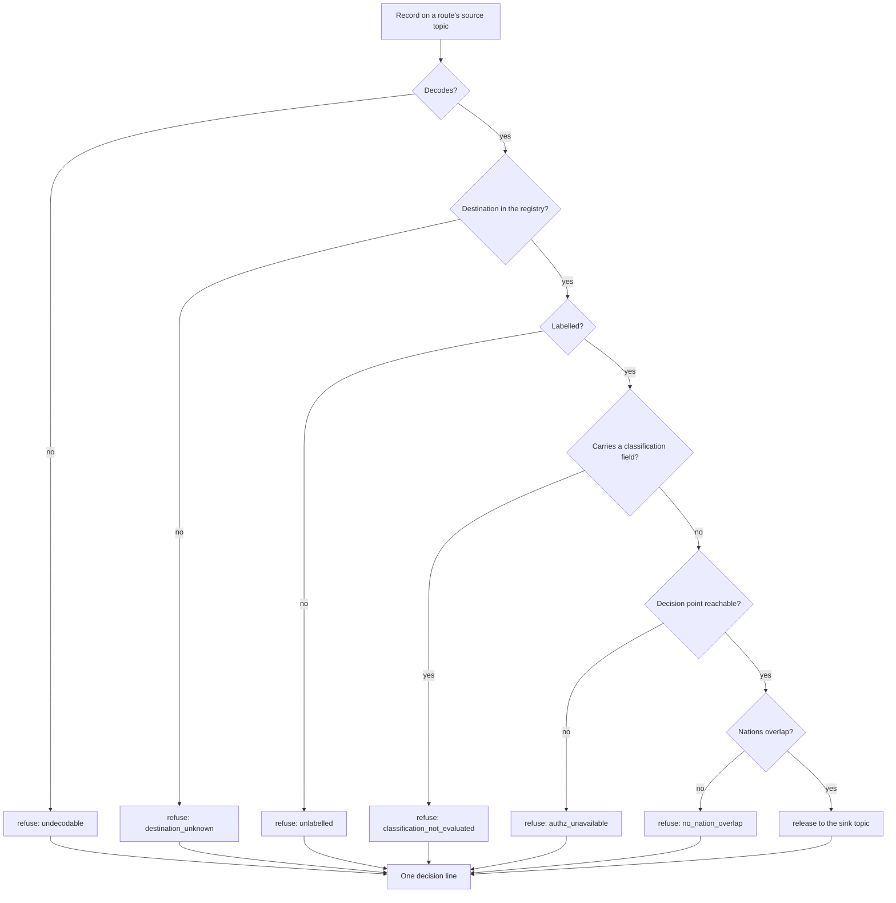

# Sample Fleet System: Security-Processes (Sc-Pr)

built on OpenDDIL 0.1.161

How a release is decided. Each record gets one decision line, and refusal is the default wherever the inputs are incomplete.

The order of the checks here is for reading. The decision record fixes the reasons, and the code fixes the order. `classification_not_evaluated` is the fence: a record carrying a classification field is refused even when its labels would pass, because the gate does not evaluate that field. Any scheme a deployment wants evaluated is {{slot:classification-scheme}}.

Intake runs the mirror of this: validate by kind, require label equality, require entitled approvers, write a local decision, then publish onward. A disagreement between two named records is surfaced to a person. Detection never enforces.

Decision-record fields and the reason list are local to this architecture and are not taken from a standard.

## Sources

| Claim | Source | Decision | Evidence |
|---|---|---|---|
| Reasons, one line per record, fail closed and loud | [ADR-0043](../../../../decisions/ADR-0043-egress-gate-one-predicate-two-subjects.md) | Proposed | Measured under compose |
| A refusal for an unknown answered record is provisional | [ADR-0046](../../../../decisions/ADR-0046-maintenance-bridge-events-out-actions-in.md) | Accepted | Not stated |
| Intake steps | [ADR-0046](../../../../decisions/ADR-0046-maintenance-bridge-events-out-actions-in.md) | Accepted | Not stated |
| An interlock refusal joins the intake's reasons | [ADR-0052](../../../../decisions/ADR-0052-safety-states-and-release-interlocks.md) | Accepted | Design only |
| Detectors are disagreements; detection never enforces | [ADR-0053](../../../../decisions/ADR-0053-logistics-cyber-detection-as-surfaced-disagreement.md) | Accepted | Design only |
| Failure detectability and degraded mode | [ADR-0036](../../../../decisions/ADR-0036-failure-detectability-and-degraded-mode.md) | Standing | Not stated |
