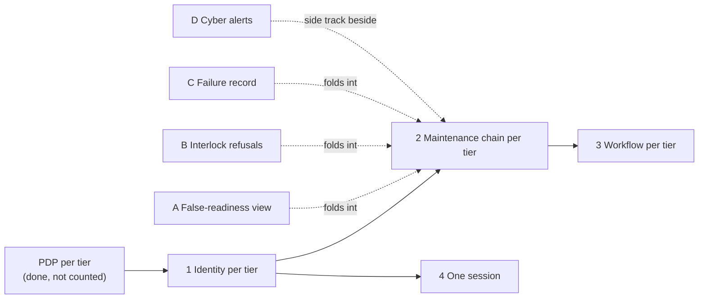

# Sample Fleet System: Strategic-Roadmap-Phasing (St-Rm-P)

built on OpenDDIL 0.1.161

Where each capability in [Strategic-Taxonomy](../../views/St-Tx.md) stands, read from the record. Phase and evidence are computed at render from [capability-record.yaml](../../capability-record.yaml), and every citation in it has to resolve or the render fails. A capability with no phase also fails the render.

Phases: 7 measured, 9 built unmeasured, 6 accepted design, 4 proposed, 2 row.

| Capability | Lane | Phase | Evidence | Built | Decisions | Rows |
|---|---|---|---|---|---|---|
| DataAcquisition | Condition monitoring | measured | 2026-09-26, lab A, The pre-flight: advancing: exit 0 | templates/edge.yaml | ADR-0038, ADR-0010 | - |
| DataManipulation | Condition monitoring | measured | 2026-09-26, lab A, The pre-flight: tier feed: clean, 45 consumers, zero unfed / unentitled / null-keyed | templates/tier-node.yaml | ADR-0038 | - |
| StateDetection | Condition monitoring | measured | 2026-09-26, lab A, The pre-flight: derive stage: COMPLETING — edge-01 +100/+16, edge-02 +80/+12, region-east +180/+56 | templates/tier-node.yaml | ADR-0038 | - |
| HealthAssessment | Condition monitoring | built unmeasured | not measured | templates/tier-node.yaml | ADR-0038 | - |
| PrognosticAssessment | Condition monitoring | built unmeasured | not measured | templates/tier-node.yaml | ADR-0038, ADR-0020 | AE-4 |
| AdvisoryGeneration | Condition monitoring | built unmeasured | not measured | templates/tier-node.yaml | ADR-0038 | AE-2 |
| InformationPresentation | Condition monitoring | measured | 2026-09-26, lab A, The pre-flight: shape sizes: TOTAL 85 KiB one client load; worst in-flight 194 KiB vs 256Mi limit | templates/tier-node.yaml | ADR-0038 | - |
| DeclaredAnalyticUnits | Condition monitoring | proposed | not measured | - | ADR-0057 | - |
| DeclaredCards | Condition monitoring | proposed | not measured | - | ADR-0058 | - |
| HierarchicalAggregation | Hierarchy | measured | 2026-09-26, lab A, E. Severance, both dimensions: rollup 4 partials / 15 assets: was 3 / 14: ⚠ see FINDING-03 §3a | templates/regional.yaml | ADR-0022 | - |
| TierLocalDecision | Isolation increments, done: PDP per tier | built unmeasured | not measured | templates/tier-node.yaml | ADR-0029 | - |
| TierLocalSignIn | Isolation increments, 1: Identity per tier | built unmeasured | not measured | templates/tier-identity.yaml | ADR-0045 | - |
| TierLocalMaintenanceChain | Isolation increments, 2: Maintenance chain per tier | accepted design | not measured | - | ADR-0046 (record: accepted; index: proposed) | - |
| TierLocalWorkflow | Isolation increments, 3: Workflow per tier | built unmeasured | not measured | templates/tier-node.yaml | ADR-0034 | - |
| OneSession | Isolation increments, 4: One session | proposed | not measured | - | ADR-0045 (names it still open) | - |
| TacticalSustainmentCorrelation | Correlation | accepted design | not measured | - | ADR-0039 | - |
| ConfigurationStatusAccounting | Correlation | measured | 2026-10-30, lab B, G. Things that will bite if forgotten: (2026-10-30, the first roll on the new image): through the Restate wipe, the in-compliance fixture asset stayed in compliance in its tier store and at HQ, with its stored part and mod times byte-identical, one restore line in the log, and no event re-sent. | templates/tier-node.yaml | ADR-0009 | - |
| ArrivalDeclaration | Correlation | built unmeasured | not measured | templates/hub.yaml | ADR-0050 | - |
| LabelledReadEnforcement | Releasability | measured | 2026-09-26, lab A, The pre-flight: completeness: ALL 4 STORES PASS, 7 populated tables, zero unlabelled; 2026-09-19, lab A, C. Releasability: Gate passes on all four stores, zero unlabelled values anywhere. | templates/tier-node.yaml | ADR-0029 | - |
| GatedRelease | Releasability | built unmeasured | not measured | templates/egress.yaml | ADR-0043 | - |
| GatedIntake | Releasability | built unmeasured | not measured | templates/egress.yaml | ADR-0046 (record: accepted; index: proposed) | - |
| DeclaredLabelDimensions | Releasability | proposed | not measured | - | ADR-0055 | - |
| SustainmentFeasibility | Anticipated | row | not measured | - | - | AE-3, AE-5, GD-10 |
| AdvisoryProvenance | Anticipated | row | not measured | - | - | AE-2 |
| OfflineIntentReconciliation | Anticipated | accepted design | not measured | - | ADR-0040, ADR-0042 | - |
| FailureReporting | Anticipated | accepted design | not measured | - | ADR-0051 | GD-15 |
| SafetyInterlockRefusal | Anticipated | accepted design | not measured | - | ADR-0052 | GD-16 |
| DisagreementDetection | Anticipated | accepted design | not measured | - | ADR-0053 | GD-17 |

Lab A is the first lab cluster and lab B the second lab cluster.

An entry is the last time the readiness doc records that check. It ran against the chart of that date, which can be older than the chart this document was rendered from. "Not measured" means the readiness doc has no entry for the capability, and says nothing about measurements recorded elsewhere.

| Phase | Meaning |
|---|---|
| measured | The readiness doc has an entry for it, with a date and a lab. |
| built unmeasured | The chart renders it, which may be behind a value that is off by default, and the readiness doc has no entry for it. |
| accepted design | A decision record accepts it, and the record cites no chart template for it. |
| proposed | A decision record proposes it or names it as still open. |
| row | It is only a tracked row in a register, with no decision behind it yet. |

## Lane: isolation increments

The order in which tiers become able to work alone. The roadmap note gives an order and its dependencies, and deliberately no dates. A deployment supplies them here: {{slot:increment-dates}}.

None of A to D is on an increment's critical path. Each can be dropped without moving the increment it folds into.

## Sources

| Claim | Source | Decision | Evidence |
|---|---|---|---|
| The order, the dependencies and the fold-ins | [Roadmap note](../../../../decisions/ROADMAP-2026-10-29-isolation-increments.md) | Roadmap note | Not stated |
| Each capability's phase and evidence | [capability-record.yaml](../../capability-record.yaml) | Generated | Generated |

The roadmap note says it is not a decision. An increment's own ADR is the decision.
