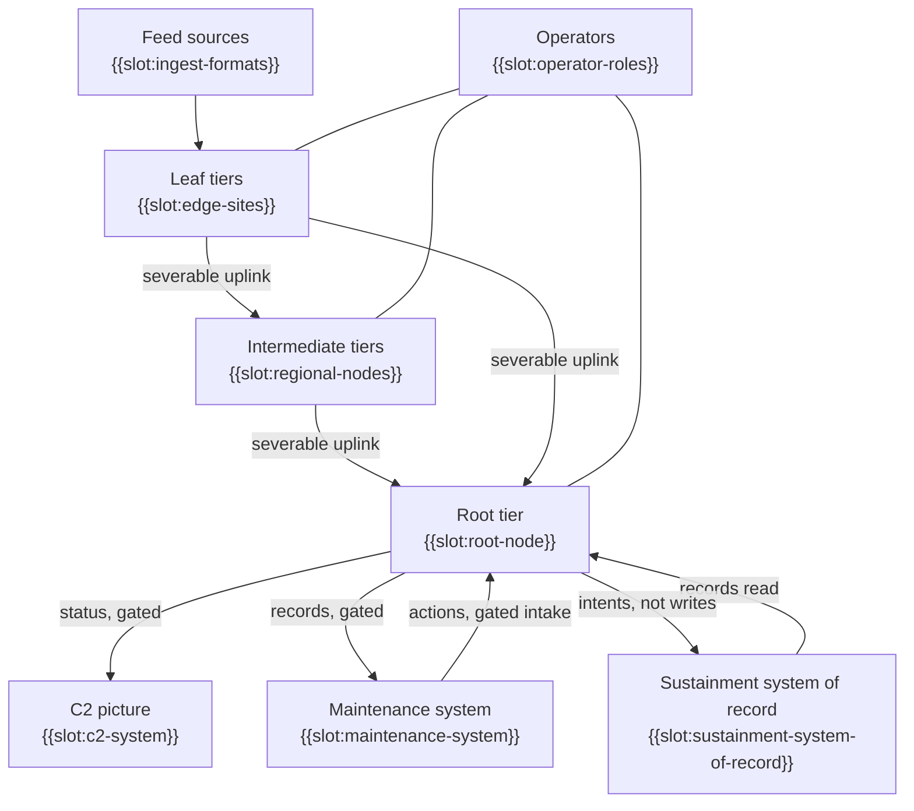

# Operational-Taxonomy (Op-Tx)

The kinds of performer, and the concept in one picture: {{slot:mission-thread}}, among {{slot:coalition-nations}}.

Root, intermediate and leaf are positions in a tree and not kinds of tier: a tier is the same kit wherever it sits.

<!-- model: OperationalNodes -->

Model: [OperationalNodes](../model/openddil.sysml)

## Sources

| Claim | Source | Decision | Evidence |
|---|---|---|---|
| Root, intermediate and leaf are positions | [ADR-0033](../../../decisions/ADR-0033-recursive-tier-hierarchy-framework-invariant.md) | Accepted | Pending |
| Three tiers aggregate in the chart today | [ADR-0023](../../../decisions/ADR-0023-hierarchy-restoration-topology-and-phase-plan.md) | Accepted | Declared |
| A consumer takes status derived from open vocabulary (Contract A) | [Interface contracts](../../../decisions/DESIGN-2026-09-06-interface-contracts.md) | Design note | Not stated |
| The system of record is read, and receives intents (Contract B) | [Interface contracts](../../../decisions/DESIGN-2026-09-06-interface-contracts.md) | Design note | Not stated |
| Records go out and actions come in through one gate | [ADR-0046](../../../decisions/ADR-0046-maintenance-bridge-events-out-actions-in.md) | Accepted | Not stated |
