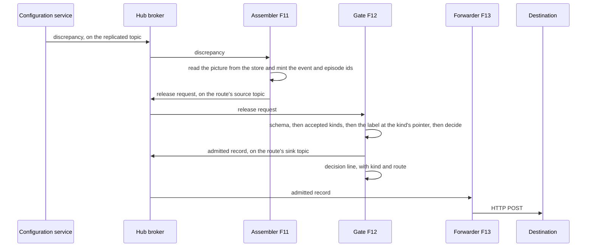
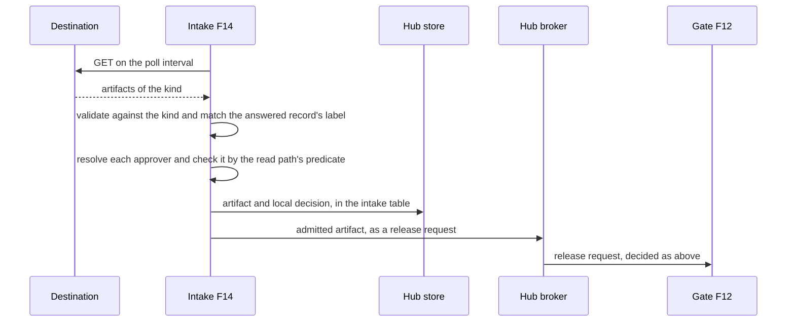

# Resources-Sequences (Rs-Sq)

The release and intake exchanges of [Operational-Sequences](Op-Sq.md), between workloads. The function numbers are those of [Resources-Processes](Rs-Pr.md). Every arrow into or out of a broker is a topic. The rendered topic names are in [Resources-Connectivity](Rs-Cn.md).

## Release

The gate's added reasons are `kind_not_accepted` and `schema_invalid`. A record that fails either is refused and logged like any other refusal. A severed tier queues at its gate's output, as any egress does.

## Intake

The intake table holds kind, key, label, body and decision, with the owning tier as a column. Storing it at the owning tier is the design, so that a severed tier holds its own decisions. Until that lands, it does not.

## Sources

| Claim | Source | Decision | Evidence |
|---|---|---|---|
| Assembler, gate and intake steps, and the intake table at the hub | [ADR-0046](../../../decisions/ADR-0046-maintenance-bridge-events-out-actions-in.md) | Accepted | Declared |
| Event and episode ids, both deterministic | [ADR-0046](../../../decisions/ADR-0046-maintenance-bridge-events-out-actions-in.md) | Accepted | Not stated |
| Gate and forwarder: one decision line per record | [ADR-0043](../../../decisions/ADR-0043-egress-gate-one-predicate-two-subjects.md) | Proposed | Measured under compose |
| Approvers decided by the read path's predicate | [ADR-0029](../../../decisions/ADR-0029-coalition-releasability-abac-enforcement.md) | Accepted | Built |
