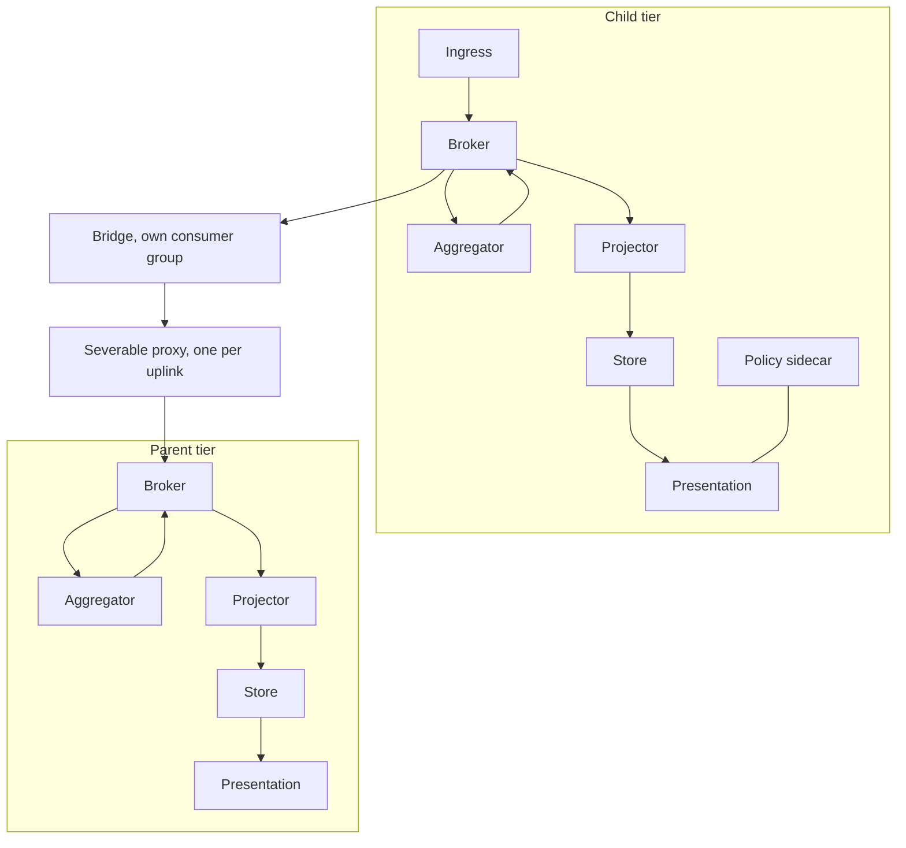

# Resources-Structure (Rs-Sr)

A tier is one kit, and a deployment decides which members each tier carries. The deployment's tree: {{slot:tier-tree}}.

<!-- model: ResourceKit -->

Model: [ResourceKit](../model/openddil.sysml)

A store needs a projector, presentation needs a store, and presentation that has to survive severance needs its own broker.

The rendered chart today gives a region no broker of its own, so a region's rows in the generated view read `none rendered` in the Broker column. The kit allows either.

## Sources

| Claim | Source | Decision | Evidence |
|---|---|---|---|
| The node kit and its dependency rules | [ADR-0033](../../../decisions/ADR-0033-recursive-tier-hierarchy-framework-invariant.md) | Accepted | Pending |
| One bridge, one consumer group and one proxy per uplink | [ADR-0021](../../../decisions/ADR-0021-edge-hq-topology-is-load-bearing.md) | Accepted | Built |
| A parent's own clients do not cross a link | [ADR-0021](../../../decisions/ADR-0021-edge-hq-topology-is-load-bearing.md) | Accepted | Built |
| Regional aggregators run across clusters | [ADR-0024](../../../decisions/ADR-0024-multi-cluster-faust-aggregator-pattern.md) | Accepted | Not stated |
| Presentation local to a tier | [ADR-0032](../../../decisions/ADR-0032-tier-local-presentation-reachback-finding.md) | Accepted | Not stated |
| Which analytics run at a tier is configuration | [ADR-0034](../../../decisions/ADR-0034-tier-analytics-are-deployment-configuration.md) | Accepted | Not stated |
| A policy decision point at each tier | [ADR-0029](../../../decisions/ADR-0029-coalition-releasability-abac-enforcement.md) | Accepted | Built |
| Seams for a co-located reasoning plane | [ADR-0031](../../../decisions/ADR-0031-converged-edge-node-reasoning-plane-seams.md) | Accepted | Not stated |
