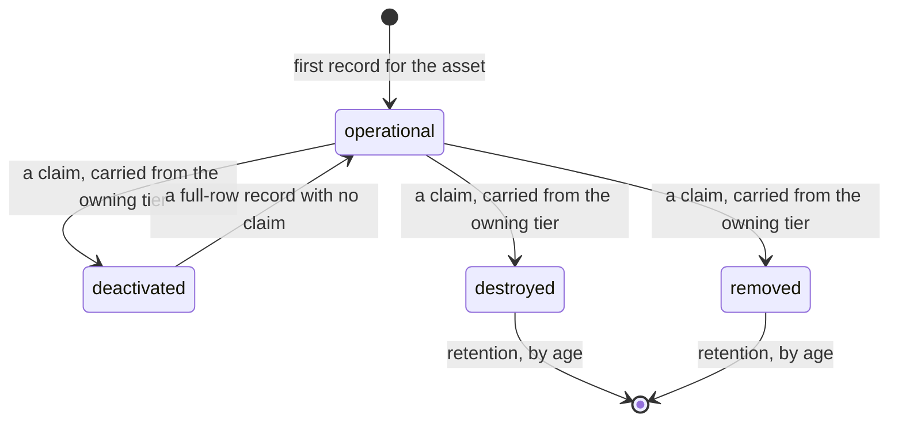
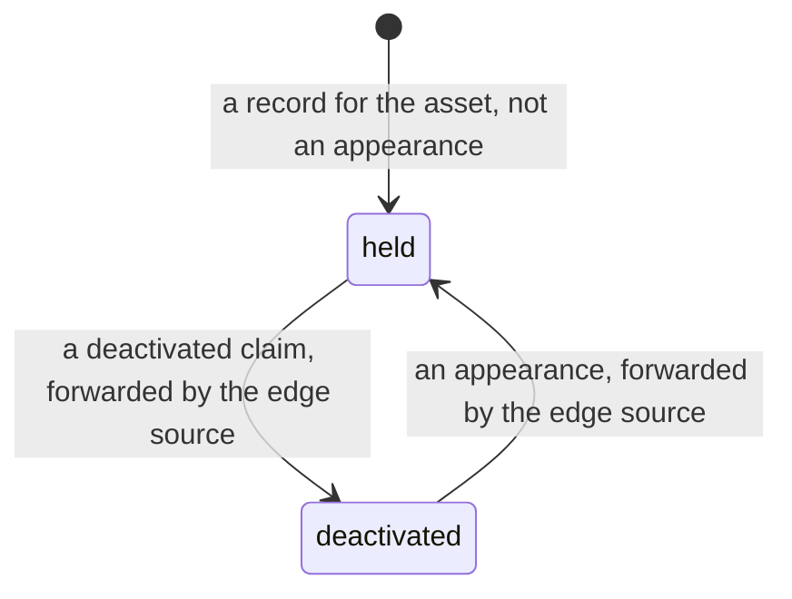

# Resources-States (Rs-St)

Where each operational state lives, and which resource may move it. [Operational-States](Op-St.md) holds the state machines themselves. This view holds the resources that store them, decide them, and carry them.

| State | Decided by | Held by | Every other resource |
|---|---|---|---|
| Operational status | The aggregator at the tier that receives the asset's own signal | That aggregator's table, then every tier's store | Adopts it as an ordinary labelled record |
| Reporting status | Each tier, for its own feed | That tier's store | Never reads another tier's |
| Posture | The aggregator at the edge tier that owns the sensor, with per-asset history | That aggregator's table, then every tier's store | Stores the decided value unchanged and never re-derives it |

A severed tier's assets therefore read `not_reporting` at its parent and `reporting` at the tier itself, both at once, and both are correct. What the parent learns is about the link.

## A row in a tier's store

The store decides one transition itself, from the record and the stored row, in the same statement: a full-row record with no claim returns `deactivated` to `operational` and stamps the time. A record without kinematics, a status-only record and a record that carries a terminal claim are not appearances. Silence changes nothing.

The diagram shows the transitions the decision record's cases name. Only `destroyed` and `removed` rows may be pruned, and only by age. A quiet asset is never prunable, at any age. The code change that adds the status condition to the pruner is not yet made, and until it is the pruner still reaps by age alone. A reset empties the stores, and that is the only path back from `destroyed` or `removed`. No restore action exists.

There is no state for an asset that should never have been a member. An id seen once and never accounted for is carried as not reporting, of unknown variant. It stays undeclared until it is labelled with that honest fact.

## An entry in a regional rollup

The edge source forwards an appearance at once after it has forwarded a `deactivated` claim, and otherwise at most once per interval per asset. The interval covers a source restart. An appearance never creates an entry, because entries are what the rollup counts.

## Sources

| Claim | Source | Decision | Evidence |
|---|---|---|---|
| Two columns, each with its timestamp | [ADR-0044](../../../decisions/ADR-0044-lifecycle-two-columns-no-deletes.md) | Proposed | Built, unit-tested |
| Operational status owned at the tier that receives the signal; reporting status local to each tier | [ADR-0044](../../../decisions/ADR-0044-lifecycle-two-columns-no-deletes.md) | Proposed | Not stated |
| Posture decided once at the owning edge tier and carried; a reset cold-starts it | [ADR-0044](../../../decisions/ADR-0044-lifecycle-two-columns-no-deletes.md) | Proposed | Not stated |
| Deactivated is reversible at the store and at the rollup; destroyed and removed return only by reset | [ADR-0044](../../../decisions/ADR-0044-lifecycle-two-columns-no-deletes.md) | Proposed | Not stated |
| Only a terminal row is prunable, by age; the pruner's predicate change is not yet made | [ADR-0044](../../../decisions/ADR-0044-lifecycle-two-columns-no-deletes.md) | Proposed | Pending |
| No state for "never a member" | [ADR-0044](../../../decisions/ADR-0044-lifecycle-two-columns-no-deletes.md) | Proposed | Not stated |
| The state axes these columns sit under | [ADR-0026](../../../decisions/ADR-0026-operational-state-orthogonal-axis-model.md) | Accepted | Not stated |
