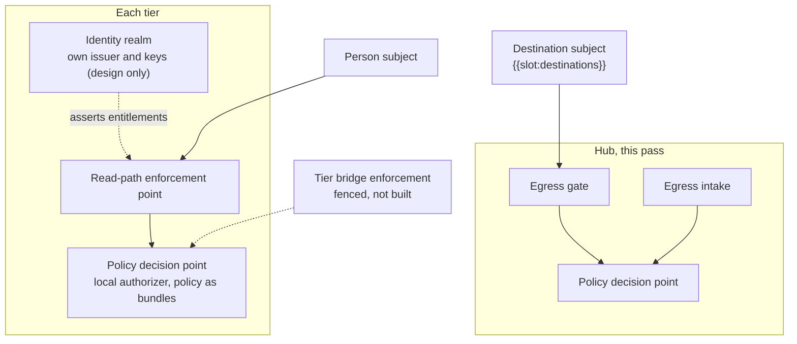

# Security-Structure (Sc-Sr)

One decision point per tier, and enforcement wherever data leaves a tier's custody. Labels come from {{slot:coalition-nations}}. Classification: {{slot:classification-scheme}}. Issuers: {{slot:idp-issuer}}.

<!-- model: SecurityStructure -->

Model: [SecurityStructure](../model/openddil.sysml)

The same predicate serves both subjects. A severed tier still decides and enforces, because its decision point is its own.

## Sources

| Claim | Source | Decision | Evidence |
|---|---|---|---|
| One decision point, many enforcement points | [ADR-0029](../../../decisions/ADR-0029-coalition-releasability-abac-enforcement.md) | Accepted | Built |
| A decision point at each tier | [Roadmap note](../../../decisions/ROADMAP-2026-10-29-isolation-increments.md) | Roadmap note | Built |
| Read-path enforcement (slice 1) | [ADR-0029](../../../decisions/ADR-0029-coalition-releasability-abac-enforcement.md) | Accepted | Built |
| Tier-bridge enforcement (slice 3) | [ADR-0029](../../../decisions/ADR-0029-coalition-releasability-abac-enforcement.md) | Accepted | Fenced |
| One predicate with the destination as a second subject | [ADR-0043](../../../decisions/ADR-0043-egress-gate-one-predicate-two-subjects.md) | Proposed | Measured under compose |
| A tier realm with its own issuer and keys, credentials at the home tier | [ADR-0045](../../../decisions/ADR-0045-per-tier-identity-realm-replicas.md) | Accepted | Design only |
| Classification is fenced from the gate's decision | [ADR-0043](../../../decisions/ADR-0043-egress-gate-one-predicate-two-subjects.md) | Proposed | Fenced |
