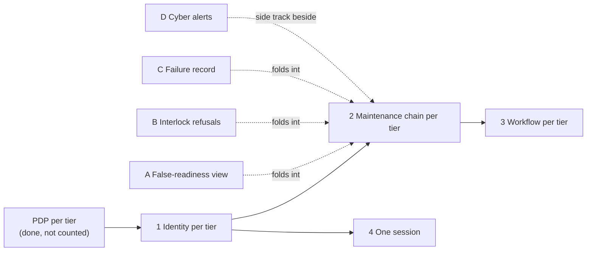

# Strategic-Roadmap-Phasing (St-Rm-P)

Where each capability in [Strategic-Taxonomy](St-Tx.md) stands, read from the record. Phase and evidence are computed at render from [capability-record.yaml](../capability-record.yaml), and every citation in it has to resolve or the render fails. A capability with no phase also fails the render.

<!-- generated: capability-phases -->

| Phase | Meaning |
|---|---|
| measured | The readiness doc has an entry for it, with a date and a lab. |
| built unmeasured | The chart renders it, which may be behind a value that is off by default, and the readiness doc has no entry for it. |
| accepted design | A decision record accepts it, and the record cites no chart template for it. |
| proposed | A decision record proposes it or names it as still open. |
| row | It is only a tracked row in a register, with no decision behind it yet. |

## Lane: isolation increments

The order in which tiers become able to work alone. The roadmap note gives an order and its dependencies, and deliberately no dates. A deployment supplies them here: {{slot:increment-dates}}.

None of A to D is on an increment's critical path. Each can be dropped without moving the increment it folds into.

## Sources

| Claim | Source | Decision | Evidence |
|---|---|---|---|
| The order, the dependencies and the fold-ins | [Roadmap note](../../../decisions/ROADMAP-2026-10-29-isolation-increments.md) | Roadmap note | Not stated |
| Each capability's phase and evidence | [capability-record.yaml](../capability-record.yaml) | Generated | Generated |

The roadmap note says it is not a decision. An increment's own ADR is the decision.
